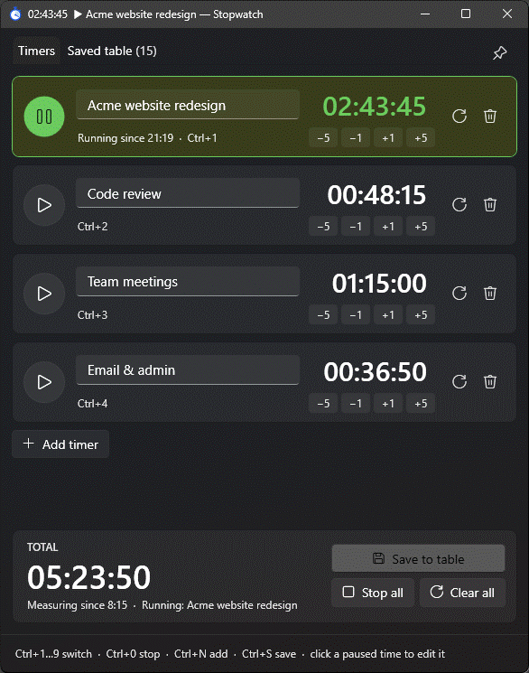
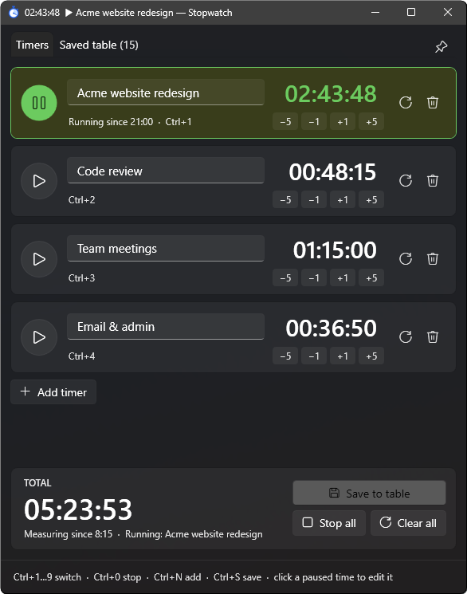
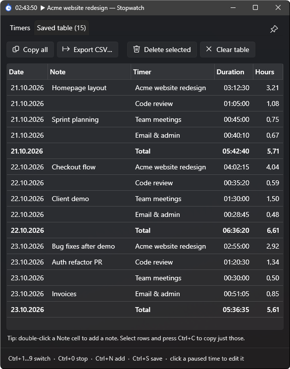

# Multiple Stopwatch Productivity Tool

A small Windows desktop app with **several named stopwatches, only one of which runs at a time**. Switch between tasks with one click or a keyboard shortcut, see where your day went, and save the totals to a table you can paste straight into Excel or a timesheet.

Built with **WPF on .NET 10** (C#, MVVM, no third-party dependencies).

<p align="center">
  
</p>

<p align="center">
  <a href="https://github.com/JoseTheChamp/Multiple-Stopwatch-Productivity-Tool/releases/latest/download/Stopwatch.exe"><b>⬇ Download Stopwatch.exe</b></a>
  &nbsp;·&nbsp; Windows 10/11 &nbsp;·&nbsp; free and open source
</p>

---

## What it's for

You work on several things in a day (projects, clients, meetings, email) and want to know how long each one really took, without fiddling with a full time-tracking service.

- Give each task its own timer, e.g. *Project A*, *Meetings*, *Email*.
- Press **Ctrl+1**, **Ctrl+2**… to switch. Starting a timer automatically pauses the one that was running, so time is never counted twice.
- At the end of the day press **Ctrl+S** to save every timer plus the total into the *Saved table*, then **Copy all** and paste it into your timesheet.

Time is calculated from the wall clock, not by counting ticks, so **a timer keeps counting even if you close the app, the PC sleeps or restarts**. When you open it again, the elapsed time is correct.

## Screenshots

<table>
  <tr>
    <td align="center"><b>Timers</b>: one runs, the rest wait.<br>The total and window title update live.</td>
    <td align="center"><b>Saved table</b>: one row per timer per day,<br>with notes and decimal hours for timesheets.</td>
  </tr>
  <tr>
    <td></td>
    <td></td>
  </tr>
</table>

## Features

**Timers**
- Any number of named timers (click a name to rename it)
- One running timer at a time; starting another pauses the current one
- Quick adjust buttons: **−5 / −1 / +1 / +5 minutes**, which work on running and paused timers
- Click a paused time to type an exact value (see [time input](#typing-a-time) below); **↑ / ↓** adds or removes a minute, **Shift+↑ / ↓** an hour
- Clear (reset to 00:00:00) or remove a single timer, *Stop all*, *Clear all*
- **Total** of all timers, and *Measuring since…* showing when you started the first timer
- The window title shows the running timer and its time, so you can see it from the taskbar

**Saved table**
- **Save to table** records each timer and the total as rows, dated by when measuring began
- Add a **note** to any row (double-click the Note cell)
- **Copy all** (tab-separated, pastes cleanly into Excel / Google Sheets / email) or select rows and press **Ctrl+C**
- **Export CSV…** for Excel (uses your system's list separator, e.g. `;` on Czech systems) or tab-separated text
- Durations shown as `hh:mm:ss` and as decimal hours (e.g. `1,25`) for timesheets
- Delete selected rows (**Del**) or clear the whole table

**Comfort and safety**
- **Undo** for clearing, removing, editing times and deleting rows
- **Always on top** pin, so the window can float above your work
- Remembers timers, the saved table, window size and position between runs
- Crash-safe saving: data is written to a temp file and swapped in, with the previous version kept as a `.bak`
- Only one copy runs at a time; launching it again brings the existing window to the front
- Follows the Windows light/dark theme (Fluent style)

## How to use it

### Keyboard shortcuts

| Shortcut | Action |
| --- | --- |
| **Ctrl+1 … Ctrl+9** | Start/pause timer 1–9 (pauses whichever other timer was running) |
| **Ctrl+0** | Stop all timers |
| **Ctrl+N** | Add a new timer |
| **Ctrl+S** | Save all timers + total to the table |
| **Enter** | Finish renaming a timer / apply a typed time |
| **Esc** | Discard a typed time (or finish renaming) |
| **Del** | Delete selected rows in the saved table |
| **Ctrl+C** | Copy selected rows |

### Typing a time

Click the time of a **paused** timer and type any of these (spaces are ignored, `,` or `.` as the decimal point):

| You type | Result |
| --- | --- |
| `1:30:00` or `1:30` | 1 h 30 min (`h:mm[:ss]`) |
| `45m`, `1h30m`, `2h 5m`, `90s` | duration with units (`h`, `m`/`min`, `s`) |
| `1,5h` | 1 h 30 min |
| `90` | a plain number means minutes, so 1 h 30 min |
| `+15m`, `-10m`, `+1h`, `-0:10` | add to or subtract from the current time |

## Installation

**Requirements:** Windows 10 or 11 and the [.NET 10 Desktop Runtime](https://dotnet.microsoft.com/download/dotnet/10.0) (the SDK is needed only to build).

### Download

Grab **[Stopwatch.exe](https://github.com/JoseTheChamp/Multiple-Stopwatch-Productivity-Tool/releases/latest/download/Stopwatch.exe)** from the [latest release](https://github.com/JoseTheChamp/Multiple-Stopwatch-Productivity-Tool/releases/latest). It's a single file with no installer: put it anywhere and run it. The exe isn't code-signed, so Windows SmartScreen may ask you to confirm (*More info → Run anyway*).

### Build and run from source

```bash
git clone https://github.com/JoseTheChamp/Multiple-Stopwatch-Productivity-Tool.git
cd Multiple-Stopwatch-Productivity-Tool
dotnet run
```

### Make a standalone `.exe` with a desktop shortcut

```powershell
powershell -ExecutionPolicy Bypass -File publish.ps1
```

This publishes a single-file `Stopwatch.exe` into `dist\` and creates (or refreshes) a **Stopwatch** shortcut on your desktop. Close the app before re-publishing. Your timers keep counting while it's closed.

## Where your data is stored

Everything is saved locally in:

```
%APPDATA%\MultiStopwatch\state.json      (plus state.json.bak, the previous version)
```

Set the `STOPWATCH_DATA_DIR` environment variable to keep the data somewhere else (e.g. a synced folder). If the file ever can't be read, the app loads the backup and keeps a copy of the unreadable file next to it.

## Project structure

```
App.xaml(.cs)           # Startup, single-instance handling, theme, global error handler
MainWindow.xaml(.cs)    # UI layout, keyboard shortcuts, time editing
ViewModels/
  MainViewModel.cs      # Timers, saved table, undo, copy/export
  TimerItem.cs          # One timer: accumulated time + "running since" timestamp
  Mvvm.cs               # ObservableObject / RelayCommand helpers
Models/
  AppState.cs           # Persisted data model and time formatting
  StateStore.cs         # Atomic JSON save/load with backup
  TimeInput.cs          # Parser for typed times ("1:30", "45m", "+15m"…)
Assets/Stopwatch.ico    # App icon (generated by tools/make-icon.ps1)
publish.ps1             # Builds dist\Stopwatch.exe and a desktop shortcut
.github/workflows/      # Pushing a v* tag builds Stopwatch.exe and publishes a GitHub release
docs/images/            # README screenshots and demo GIF
```

## License

[MIT](LICENSE)
